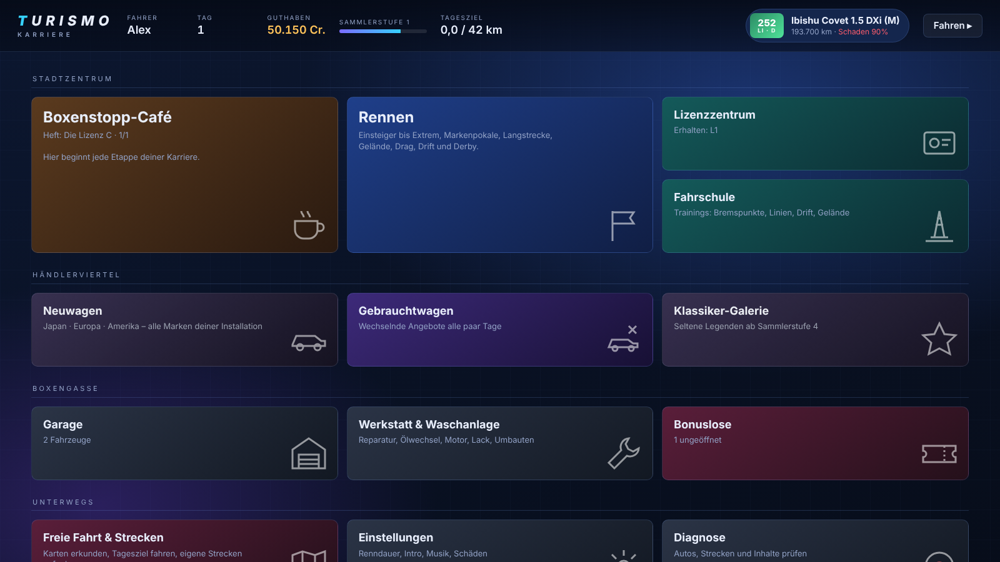

# Turismo – Karriere-Mod für BeamNG.drive 0.40

Eine eigenständige Karriere im Stil der großen Rennspiel-Klassiker: Café-Hefte als roter Faden, Lizenzen, Händler, Werkstatt mit **dauerhaften Schäden**, Rennserien in neun Hallen und eine deutlich klügere KI mit Fahrercharakteren. Alle Namen, Texte, Grafiken und Sounds sind eigene Arbeit; die Musik ist von Kevin MacLeod (CC BY 4.0, siehe [CREDITS.md](CREDITS.md)).



## Was drin ist

| Bereich | Inhalt |
|---|---|
| **Karriere** | 3 Spielstände, 4 Gegnerstärken, Fortschritt über 20 Café-Hefte oder „Klassisch“ (alles offen), Schadensmodus realistisch/nur Mechanik/aus, Hardcore-Modus |
| **Lizenzen** | C, B, A, I, S + Rallye + Drift (50 Tests): Anfahren/Bremsen, Slalom, Schikane, Haarnadel, Rundenzeiten, Gelände. Gold/Silber/Bronze, Vorführung durch die KI, Geschenkauto bei allen Goldmedaillen |
| **Fahrschule** | 10 freiwillige Trainings |
| **Rennen** | 53 Serien in 9 Hallen: Einsteiger, Amateur, Profi, Extrem, Langstrecke, Markenpokale (10 Marken), Regional, Gelände, Spezial |
| **Rennarten** | Rundstrecke, K.O.-Rennen, Verfolgung, Zeitfahren, Bergrennen, Touge-Duelle, Drift, Destruction Derby, Transport-Aufträge, Crawling, Drag-Wochenende (Qualifying + K.O.-Leiter, Sportsman/Pro-Baum, Bracket mit Dial-In) |
| **Rennformat** | Schnelles Rennen oder Rennwochenende (Training → Qualifying → Startaufstellung). Kamerafahrt vor dem Start (Luftbild → Startaufstellung → Orbit ums Auto), Einführungsrunde im Feld mit Tempolimit (~80 km/h) und fliegendem Start |
| **Leistungsindex (LI)** | 100–1000 aus Leistung, Gewicht, Beschleunigung, Antrieb und Kategorie; Klassen E–X. Verschleiß und Schaden senken den effektiven LI |
| **Autos** | Funktioniert mit allen Autos deiner Installation (auch Mods) – Händler, Rennfelder und Bedingungen arbeiten mit Kriterien statt fester Modellnamen |
| **Händler** | Neuwagen nach Region/Marke, Gebrauchtwagen (rotierend, mit Laufleistung und Verschleiß), Klassiker-Galerie ab Sammlerstufe 4 |
| **Werkstatt** | Wäsche, Ölwechsel, Schnell-/Komplettreparatur, Motorüberholung, Lack, Umbau auf andere Werksvarianten |
| **Schäden** | Teilezustand wird nach jedem Rennen gespeichert und beim nächsten Einsatz wiederhergestellt – nichts repariert sich von selbst |
| **KI** | 90 Fahrer mit Stufe (Rookie bis Legende) und Stil (sauber, aggressiv, defensiv, Spätbremser): Patzer, Angriffe, Verteidigung, Blaue Flagge, Ermüdung, Schadensfahrweise, Bergung |
| **Oberfläche** | World-Menü, eigenes Fahrer-HUD (Position, Runden, Abstände, Tacho/Drehzahl), Startampel, Drag-Baum, Ergebnis-Screens, Notfall-Menü (IMGUI) |
| **Audio** | 20 synthetisierte UI-/Renn-Sounds, 18 Musikstücke von Kevin MacLeod (Lounge, Bossa, Funk, Rock, Electro; CC BY 4.0) |
| **Werkzeuge** | Streckenrekorder für eigene Strecken, Diagnose-Seite, automatische Tests |

## Schnellstart
Siehe [docs/INSTALL.md](docs/INSTALL.md). Kurz: `turismo_karriere.zip` nach `Dokumente/BeamNG.drive/0.40/mods/` kopieren, Spiel starten und im Hauptmenü **Turismo Karriere** unter **Mehr** wählen. Während der Fahrt: `Esc` → **Mods** → **Turismo-Menü**.

## Projektaufbau
```
mod/                         ← Inhalt des Mod-Zips
  scripts/turismo_career/    modScript (lädt die Mod)
  lua/ge/extensions/turismo/ 24 Lua-Module (Logik)
  lua/vehicle/extensions/    Drag-KI im Fahrzeug
  data/turismo/              Inhalte als JSON (Serien, Lizenzen, Hefte, Fahrer …)
  ui/modules/apps/TurismoHub/ Oberfläche, Sounds, Musik
tools/                       Generatoren (Inhalte, Sounds, Musik), Tests, UI-Vorschau
docs/                        Design, Prüfliste, offene Fragen, Roadmap
```

## Entwicklung
```
python3 tools/gen_data.py     # Inhalte neu erzeugen
python3 tools/gen_sfx.py      # Soundeffekte
python3 tools/import_music.py <mp3-ordner>   # Musik (MP3s von incompetech.com -> OGG + playlist.json)
luajit tools/test/unit.lua    # Logik-Tests (25)
luajit tools/test/smoke.lua   # Karrierestart-Test (21)
node tools/ui-preview/shoot.js out/   # UI-Screenshots
bash tools/build.sh           # Zip bauen
```
